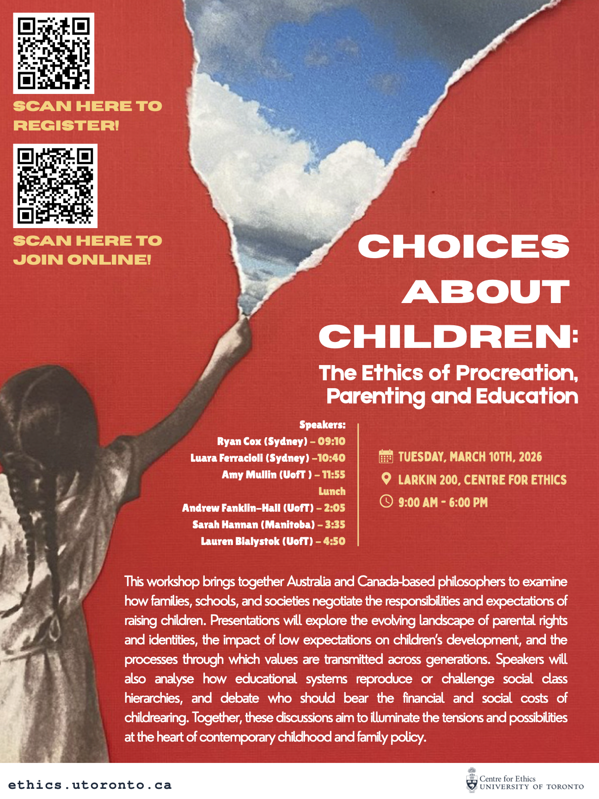

Excited to be part of the workshop "Choices About Children: The Ethics of Procreation, Parenting and Education" at the Centre for Ethics at UoT today. Here's a description of the workshop:

> This workshop brings together Australia and Canada-based philosophers to examine
how families, schools, and societies negotiate the responsibilities and expectations of
raising children. Presentations will explore the evolving landscape of parental rights
and identities, the impact of low expectations on children’s development, and the
processes through which values are transmitted across generations. Speakers will
also analyse how educational systems reproduce or challenge social class
hierarchies, and debate who should bear the financial and social costs of
childrearing. Together, these discussions aim to illuminate the tensions and possibilities
at the heart of contemporary childhood and family policy.

Here's the poster:

{width=100%}
